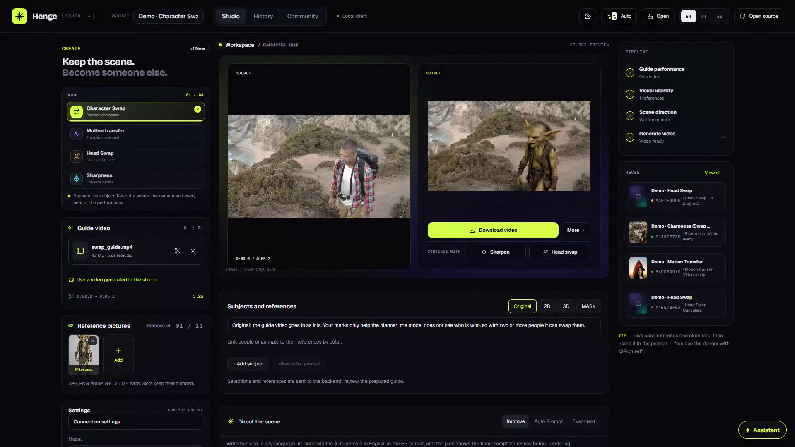
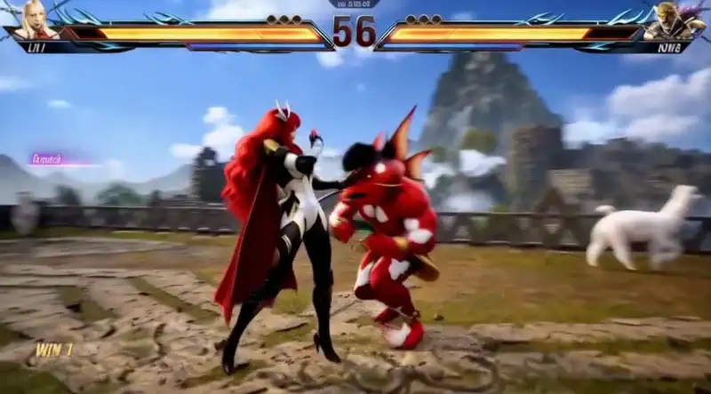
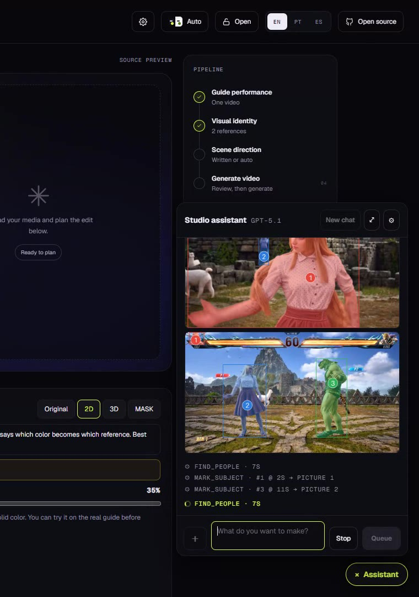
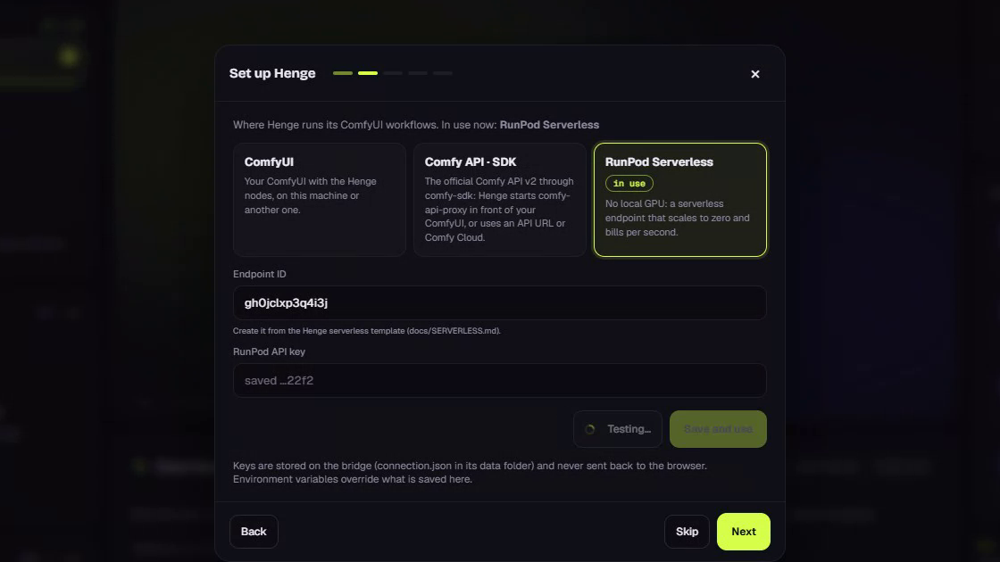
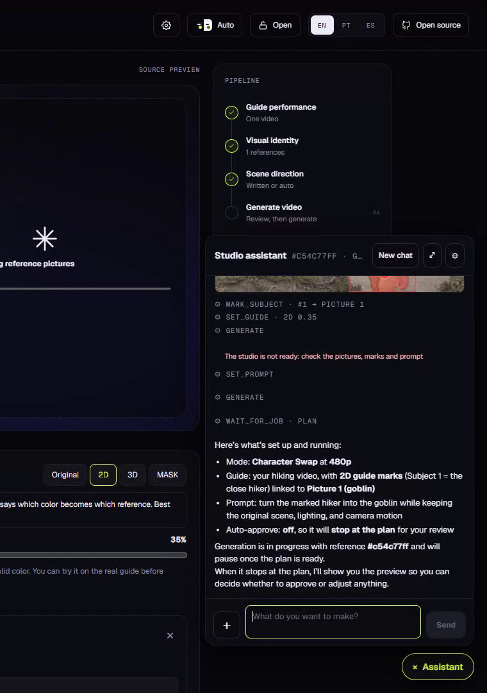
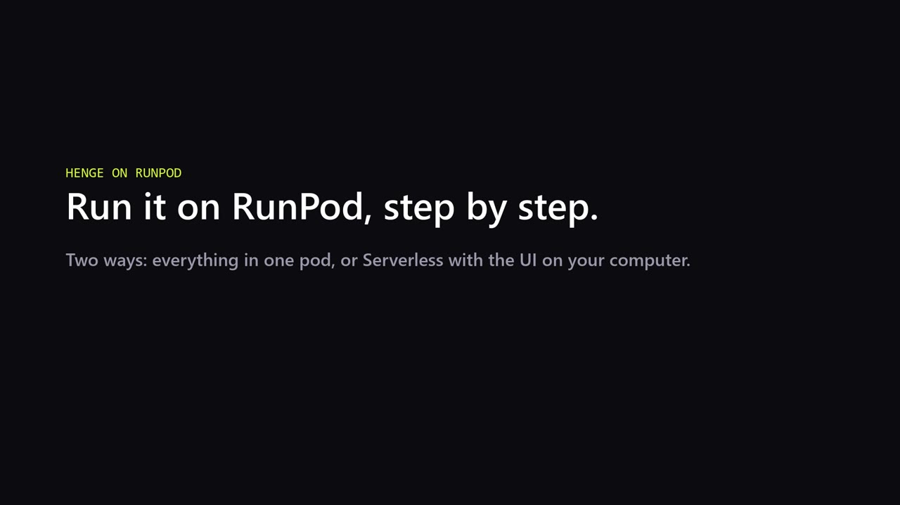

# Henge

**Swap · Motion · Transform.** An open-source video studio on ComfyUI and MiniMax H3: give it one guide video and a
few pictures, and it swaps characters, transfers motion, swaps heads or sharpens the video — locally, on a RunPod pod
or on RunPod Serverless.

[Changelog by date](CHANGELOG.md) — changes, tests and publish/deploy status.

[](https://github.com/alisson-anjos/Henge/releases/download/demo-v1/henge-demo-under-2min.mp4)

[Watch the demo — 1:58](https://github.com/alisson-anjos/Henge/releases/download/demo-v1/henge-demo-under-2min.mp4)
· [Download the complete demo — 4:04](https://github.com/alisson-anjos/Henge/releases/download/demo-v1/henge-demo.mp4)
· [50-second feature reel](https://github.com/alisson-anjos/Henge/releases/download/demo-v1/henge-teaser.mp4)

| Character Swap | Motion Transfer |
|---|---|
|  |  |
| **Head Swap** | **Sharpness** (Swap result, 480p → 1080p) |
|  |  |

Left: guide · right: Henge. All four ran on RunPod Serverless at 480p (Sharpness to 1080p), started from the
[MCP server](docs/MCP.md).

**Multi-character swap.** Both fighters swapped at once across camera cuts, 30 s rendered as three shots at 480p: the
studio assistant found the fighters, marked each one with its color (SAM 3.1 tracking) and generated.

| Result (guide inset) | The assistant marking the fighters |
|---|---|
|  |  |

Fight footage: TEKKEN DADDY (YouTube), Tekken 8 © Bandai Namco — used here as a test clip.

### Not just an interface

- **Task-specific trained LoRAs**: Character Swap v1.1, Motion Transfer v1.0 and TARA v1.0,
  Head Swap v1.0 and Little More Sharpness v1.0 (+ an H3 latent upscaler). They come from the BFS LoRA collection,
  all trained by Alisson Anjos ([alissonerdx](https://huggingface.co/Alissonerdx/Minimax-H3-ComfyUI)).
- **Guide-latent training**, a method inherited from LTX's guide-latent IC-LoRAs and brought to MiniMax H3: the
  guide's VAE latents share the output's frame grid, so frame N is built on frame N of the guide. Pose, camera and
  timing are guided directly by the source ([how the guide reaches H3](docs/conditioning.md)).
- **TARA-H3 (Temporally Aligned Reference Attention)**, our method: keeps the guide as a native video reference, puts it
  on the generated video's temporal clock and biases each output moment to attend to the matching guide moment, with no
  extra trained layers ([technical report](https://github.com/alisson-anjos/ai-toolkit/tree/tara-h3-v0.1.2/research/tara-h3)).
- **Longer clips, shot by shot**: long clips are split at camera cuts or at a fixed length, with context frames carried
  between segments within a scene. Camera cuts start clean shots; outputs are joined without crossfade or automatic
  color matching. Each shot can be previewed, redone alone and downloaded.
- **Subject guidance**: mark people (SAM 3.1 tracking) and bind each to its pictures, as 2D color marks, a 3D body or a
  latent mask for region-restricted edits. Original is the default; masks require subject marks and are opt-in.
- **A studio assistant** using the built-in planner VLM, Claude or an OpenAI-compatible model (including LM Studio),
  or **your own AI client through MCP**; a **first-run wizard** for the backend; [export a shot with its ComfyUI workflow and inputs](docs/workflow-export.md)
  to re-run it in ComfyUI.

| Studio | Setup wizard | Assistant |
|---|---|---|
|  |  |  |

Demo footage: [Pexels](https://www.pexels.com/license/) videos and original AI-generated characters.
Project references and community acknowledgements, including crinklypaper's moving-plate contribution, are collected
in [docs/REFERENCES.md](docs/REFERENCES.md).

## Modes

| Mode | What it does | Recipe |
|---|---|---|
| Character Swap | Replace the person in a video with a character picture | Character Swap v1.1 LoRA + turbo; v1.1 one-line `body_swap:` prompt; reference background removed (BiRefNet, #808080, 0.5 MP) |
| Motion Transfer | Drive people, objects or vehicles with the guide's performance | Two trained LoRAs: Guide Latents and Motion Transfer TARA v1.0, each stacked on training adapter V2; use the matching method |
| Head Swap | Replace only the head with a face picture | Head Swap v1.0 r32 + turbo; published `head_swap:` template |
| Sharpness / Upscale | Enhance an upload or an existing Henge result | Little More Sharpness first, then **Open-H3 Refiner + LMS** by default at 1080p/2K; H3 latent upscale, NVIDIA VSR and no upscale are alternatives. 4K requires an alternative method |

**Defaults.** The studio opens in **Motion Transfer TARA** (TARA model and method). New generations use **DMAD** (Kijai) at **8 steps**, CFG 1, sampler Auto (Sharpness keeps its
Open-H3 first pass, DMAD at 4 steps); DMD 8-step
is used while the DMAD file is not installed. **New** returns every setting to these defaults. Other turbos, including Pika H3 Flex, stay selectable in Advanced.

**Choosing a replacement mode.** For multiple people, objects or vehicles, we recommend **Motion Transfer TARA**:
its LoRA was trained for these edits. Select both the **Motion Transfer TARA LoRA** and the **TARA method**.
Character Swap may work as an alternative when all subjects being replaced are people; clear prompts and reference
assignments are especially important. References can have different roles: they do not have to be a person plus a
background. See [Motion Transfer examples and setup](docs/motion-transfer.md).

**Guide representation.** Original is the default, including for vehicles and objects. For marked subjects, 2D paints
each one with its color, 3D uses a colored body (people only), and Mask restricts replacement to the marked region.
Mask is not selected automatically and needs subject marks bound to references. With Original, unchanged background
pixels are not guaranteed. SAM tracks marks through the frames; assignments still need checking after camera cuts.

**Generation controls.** Model, method, turbo LoRA, steps, CFG, seed, reference preparation and Comfy Kitchen attention
are configurable. [Pika H3 Flex](docs/pika-h3-flex.md) is included in default downloads as an optional turbo: selecting
it presets six steps, CFG 1 and LCM with the Comfy workflow's manual sigmas. The H3 sampler is adjustable in Advanced;
custom step counts use the normal scheduler and remain experimental. **The Pika LoRA is not MIT-licensed**;
see [License](#license). Use a fixed seed to compare changes; the used seed is saved with each generation. Guide Latents can
send **Latents + CLIP** (UI default), **Latents only**, or use each model's **Auto** setting. Latents only can help when
source appearance leaks into a replacement. Optional [pure temporal windows](docs/temporal-windows.md) combine
predictions at each denoising step; they are distinct from shots and carried context frames, and are off by default.
In Sharpness, **Segments → full-video refiner windows** keeps normal first-pass segments and refines the assembled
result with windows; long outputs still use bounded refinement chunks for host RAM. Both window strategies require
updated Henge worker nodes. Comfy Kitchen with TARA needs the [modified kernel](docs/motion-transfer.md), not just the stock package.

**Sharpness defaults.** Entering Sharpness selects 1080p when coming from 480p/720p. Open-H3 Refiner + LMS presets the
first pass to **DMAD, 4 steps and CFG 1**; the second pass defaults to **2 refiner steps**. These are separate passes,
and the first-pass settings remain editable. This path uses the existing Ref2VA base, not FL2VA, and supports 1080p
and 2K, not 4K. It requires the `regenerate` weights and native ComfyUI upscaler nodes. See
[setup and limits](docs/open-h3-regenerate.md).

**Audio and scene controls.** Keep the source audio, generate audio with H3, or enable guide-audio conditioning.
An optional **New background** picture follows the guide camera (moving plate). **FLUX Klein** can prepare references
or edit frames; available editors depend on the installed profiles.

## How to run Henge

> **Quickest way:** give [docs/AI_GUIDED_INSTALL.md](docs/AI_GUIDED_INSTALL.md) to a coding agent (Claude Code, Codex, Cursor); it checks your machine, asks which option you want and installs it.

Henge has three parts: the **web UI** (port 8188), the **bridge** (port 8766, plans jobs, cuts and joins
video with ffmpeg) and **ComfyUI** (runs the MiniMax H3 graphs on a GPU). Pick where each one runs:

| | A. Local, your ComfyUI | B. RunPod, all in one pod | C. Local UI + RunPod Serverless |
|---|---|---|---|
| UI and bridge | your PC | the pod | your PC (no GPU needed) |
| ComfyUI / GPU | your PC (NVIDIA; memory depends on resolution and method) | the pod | RunPod workers, started per job |
| You pay | nothing extra | while the pod is on | per second while a job runs (+15 s idle) and the volume's storage |
| Startup | existing ComfyUI and models | first boot downloads the selected profiles | worker cold start after idle; timing depends on availability and model loading |
| Live sampling preview | yes | yes | progress only |
| Best for | you have an RTX 5090 or similar | long sessions | occasional use, no local GPU |

The GPU backend needs the selected model profiles (H3 base, text encoder, VAE, planner VLM and task LoRAs).
Storage depends on the profiles; the pod examples allocate a 180 GB volume. The UI/bridge-only host does not need
these weights or a GPU. [Models and download links](docs/models-and-downloads.md). The Motion Transfer LoRAs are public in [Alissonerdx/Minimax-H3-ComfyUI](https://huggingface.co/Alissonerdx/Minimax-H3-ComfyUI) (BFS Motion Transfer license), and so are the FFP and Solar merges.
**Downloading the default model profiles needs no Hugging Face token.** RunPod Serverless still requires your
RunPod API key and endpoint ID in the bridge configuration. For model downloads, the exception is the optional `klein3`
profile (FLUX.3 [image klein]), which is gated by Black Forest Labs: accept its license on
[Hugging Face](https://huggingface.co/black-forest-labs/flux-3-image-klein-comfy) and set `HF_TOKEN`. Without it, the
default FLUX.2 [klein] 4B (Apache-2.0) edits frames and pictures.

### A. Local, with your own ComfyUI

You need a working ComfyUI (PyTorch with CUDA 13, NVIDIA driver 580+), Node.js 22.6+, Python 3.10+ and
`ffmpeg`/`ffprobe` on the PATH.

1. Get Henge and the nodes:

   ```sh
   git clone https://github.com/alisson-anjos/Henge.git && cd Henge
   npm ci && npm run build
   ln -s "$PWD/backend/comfy_nodes/henge" /path/to/ComfyUI/custom_nodes/henge
   git clone https://github.com/alisson-anjos/ComfyUI-BFSNodes.git /path/to/ComfyUI/custom_nodes/bfsnodes
   /path/to/comfy/python -m pip install -r /path/to/ComfyUI/custom_nodes/bfsnodes/requirements.txt -r backend/requirements.txt
   ```

   On Windows, copy the `backend/comfy_nodes/henge` folder into `custom_nodes` instead of the link.
2. Download the models into ComfyUI (choose profiles; see the table in [SERVERLESS.md](docs/SERVERLESS.md#what-goes-on-it)):

   ```sh
   /path/to/comfy/python scripts/download_models.py \
     --manifest config/model-repos.example.json --models-dir /path/to/ComfyUI/models \
     --profiles character,motion,headswap,sharpness,regenerate,klein,sam2d,audio
   ```

   No token needed. Models you already have in ComfyUI are reused, even under another name or subfolder.

3. Start ComfyUI on port 8189 (keep it on localhost):

   ```sh
   python main.py --listen 127.0.0.1 --port 8189 --preview-method taesd --fast-disk
   ```

4. Create `.env.local` in the Henge folder:

   ```dotenv
   COMFY_BASE_URL=http://127.0.0.1:8189
   COMFY_ROOT=/path/to/ComfyUI          # optional: enables the model checklist
   HENGE_DATA_DIR=/path/to/henge-data   # jobs, uploads and results
   ```

   Machine-specific values (other hosts, keys, a login for remote access) go only in `.env.local`, which Git
   ignores; `.env.example` lists every option and [what to change](docs/RUN_LOCAL.md#what-to-change-for-your-machine).

5. Start the bridge and the UI, then open http://127.0.0.1:8188:

   ```sh
   PYTHON=/path/to/comfy/python scripts/local_stack.sh start   # also: status, stop
   ```

   On Windows, run the two commands from [RUN_LOCAL.md](docs/RUN_LOCAL.md#4-start-the-job-bridge) in two
   terminals. The backend (ComfyUI address, Comfy SDK or RunPod Serverless) can also be set in the UI: gear in the top bar → **Connection**.

Details and troubleshooting: [docs/RUN_LOCAL.md](docs/RUN_LOCAL.md).

### B. RunPod, everything in one pod

**Video tutorial (4 min), both RunPod options step by step:** network volume, the pod template, the first boot,
the Serverless endpoint and the UI on your computer.

[](https://www.youtube.com/watch?v=sthVq1_jPtM)

[Watch on YouTube](https://www.youtube.com/watch?v=sthVq1_jPtM) · [download the video](https://github.com/alisson-anjos/Henge/releases/download/demo-v1/henge-runpod-tutorial.mp4)

One container runs the UI, the bridge and ComfyUI; models download on the first boot into the pod volume.

1. **[Deploy the Henge template on RunPod](https://console.runpod.io/deploy?template=mnxax277c8)** — image, disks, ports and environment are already set
   (new to RunPod? [create your account with our link](https://get.runpod.io/z4bz8o1va7a7)).
2. Optional: a network volume keeps the models when the pod is deleted and can also feed a Serverless endpoint
   (option C). Create it first (*Storage → New volume*, 180 GB, in the datacenter of the GPU you want) and pick it
   under *Region → Network volume*. Without one, the models stay on the pod's own volume.
3. Pick a GPU with more than 32 GB (CUDA 13 driver) → *Deploy Pod*. No variable needs changing; optional:
   `HENGE_MODEL_PROFILES` to download fewer models, `HENGE_PASSWORD` to require a login (or turn it on later from the
   🔓 button in the UI, see [Login](#login-optional)).
4. Open **Connect → HTTP 8188**: the setup screen shows each model's download (about 10 minutes) and opens the
   studio when they are ready.

Stop the pod when you are done: the volume keeps the models and your job history for the next one.
Details: [docs/RUNPOD.md](docs/RUNPOD.md).

### C. UI on your PC, GPU on RunPod Serverless

The UI and bridge run on your computer; each job stage (plan, reference editing, every shot) is one request to a
serverless endpoint, whose workers start on demand and stop 15 s after the last request.

Every step can also be done in the RunPod console, without scripts: see
[docs/SERVERLESS.md](docs/SERVERLESS.md) (volume filled by the pod template, then *Serverless → New endpoint →
Docker image*).

1. [Create a RunPod account](https://get.runpod.io/z4bz8o1va7a7) if you have none and install
   [`runpodctl`](https://github.com/runpod/runpodctl) with your API key.
2. Put the models on a network volume (once; a temporary pod downloads them and is deleted):

   ```sh
   VOLUME_GB=180 scripts/runpod_volume.sh            # prints the volume id
   ```

3. Create the endpoint; the script makes the worker template in your account from the public Henge image (RunPod
   does not allow public serverless templates). The script defaults to RTX 5090; select a larger GPU if your workload
   needs it, and choose one available in the volume's datacenter:

   ```sh
   VOLUME_ID=<volume id> scripts/runpod_serverless.sh   # prints the endpoint id
   ```

4. Run the UI on your computer and open http://localhost:8188:

   ```sh
   docker run -p 8188:8188 -v henge-state:/state -e HENGE_BACKEND=runpod \
     -e RUNPOD_ENDPOINT_ID=<endpoint id> -e RUNPOD_API_KEY=<api key> \
     ghcr.io/alisson-anjos/henge-ui:latest
   ```

   Without Docker: clone Henge, `npm ci && npm run build`, install `backend/requirements.txt`, put
   `HENGE_BACKEND=runpod`, `RUNPOD_ENDPOINT_ID`, `RUNPOD_API_KEY` and `HENGE_DATA_DIR` in `.env.local`, then
   `scripts/local_stack.sh start`.

Media of any size go through the endpoint's volume; nothing uses S3 or another storage service.
Details, costs and troubleshooting: [docs/SERVERLESS.md](docs/SERVERLESS.md).

### Updating

Wait until active jobs finish before restarting the UI/bridge or recycling workers. A bridge restart interrupts
job orchestration. Publishing code, building an image and deploying it are separate steps.

- **A**: `git pull && npm ci && npm run build`, then `scripts/local_stack.sh start` and restart ComfyUI (the
  henge nodes changed).
- **B**: deploy a new pod from the template (the volume keeps the models).
- **C**: pull the new `henge-ui` image; for the workers, `ENDPOINT_ID=<id> TEMPLATE_ID=<id>
  IMAGE=ghcr.io/alisson-anjos/henge:sha-<commit> scripts/runpod_serverless.sh` switches the image and recycles
  the old workers. Run it only once no jobs are active. New weights must be added to the shared volume first;
  Startup/rendering does not run the downloader. Alternatively, use **Settings → Models** with an updated worker
  to explicitly install catalogued weights through the existing endpoint, without a fill pod.
- **UI hosted elsewhere** (optional): see [Hosting only the UI](docs/HOSTING-UI.md) (Render, a VPS, Fly.io,
  Railway). For Render, see [redeploying the image](docs/RENDER.md): changing `latest` in the registry alone
  does not update an image-based service. Update UI/bridge for interface and assistant changes; update the worker
  when graphs, nodes or GPU dependencies change.

Images are built by GitHub Actions for each release (a pushed `v*` tag, e.g. `v2026.10.30`, or a manual run of the
**Docker image** workflow) and published to GitHub Container Registry: `ghcr.io/alisson-anjos/henge` (everything; the
serverless worker uses it with `HENGE_ROLE=worker`) and `ghcr.io/alisson-anjos/henge-ui` (UI and bridge only), tagged
`latest`, the release tag and `sha-<commit>`. Commits on `main` alone do not publish an image. Pin a built SHA tag for reproducible worker versions;
`latest` follows newly published images but does not update already running workers.

### More guides

- **[AI-guided installation](docs/AI_GUIDED_INSTALL.md)**: paste one prompt into Claude Code, Codex or Cursor and it installs Henge for you
- [Use Henge from your own AI client through MCP](docs/MCP.md) (instead of the built-in assistant)
- [References and acknowledgements](docs/REFERENCES.md)
- [Instructions for an AI agent to deploy everything on RunPod](docs/AGENT_DEPLOY.md)
- [Run locally: ports, connection settings, Windows](docs/RUN_LOCAL.md)
- [Docker Compose on your own GPU machine](docker/README.md)
- [RunPod pod template](docs/RUNPOD.md) · [RunPod Serverless](docs/SERVERLESS.md)
- [Models and download links](docs/models-and-downloads.md) · [Guide conditioning](docs/conditioning.md)
- [Motion Transfer workflows](workflows/README.md) · [Flexible references and modified Kitchen kernel](docs/motion-transfer.md)
- [Open-H3 Refiner + LMS](docs/open-h3-regenerate.md) · [Temporal processing](docs/temporal-windows.md)
- [Pika H3 Flex turbo, sampling and downloads](docs/pika-h3-flex.md)
- [Portable ComfyUI workflow exports](docs/workflow-export.md)

## Login (optional)

The UI is open by default: anyone who reaches its address can start jobs on your GPU or your RunPod account. Before
you share it (a tunnel such as `cloudflared tunnel --url http://localhost:8188`, a Tailscale address, or a pod's
public port), turn on a login. You can do it in either of two ways:

- **From the UI:** click **🔓 Open** in the top bar, choose a user and a password (8+ characters) and press
  **Require login**. The browser asks for it right away. The login is saved as a scrypt hash in `access.json` in the
  bridge data folder (`HENGE_DATA_DIR`), so it survives restarts; the same button changes it or turns it off.
- **From the environment** (for pod templates and scripts), it overrides the UI setting:

  ```dotenv
  HENGE_PASSWORD=choose-one
  HENGE_USER=henge   # optional, default "henge"
  ```

The login covers every page and every `/api` route, including the assistant and its key settings. What stays behind
it:

| Service | Port | Protection |
|---|---|---|
| Henge UI | 8188 | the login above |
| Bridge (FastAPI) | 8766 | listens on `127.0.0.1` only; reached through the UI |
| ComfyUI | 8189 | listens on `127.0.0.1` only. `HENGE_EXPOSE_COMFY=1` opens it **without any login**: debugging only |
| RunPod Serverless worker | — | only callers with your RunPod API key; the key stays in the bridge's environment |

## Real people (optional filter)

Set `HENGE_LIKENESS_FILTER=warn` to have the planner warn when a reference picture looks like a real public figure,
or `block` to stop such jobs before they generate. It is `off` by default. Only generate real people with their
consent.

## Assistant and automatic prompts

The built-in assistant can use the same **Qwen planner VLM** as generation, on the configured ComfyUI/Serverless
backend, without an external API key. Settings also supports Claude or an OpenAI-compatible provider such as LM
Studio. When a replacement request does not specify a mode, the assistant offers an in-chat choice: **Motion Transfer
TARA** is recommended for multiple subjects; Character Swap is an alternative only when all targets are people.
Choosing TARA applies its LoRA profile and method together.

The assistant reads current generation settings and worker capabilities before rendering. Optional Molmo tools are
shown only when configured; without Molmo it inspects guide frames. Molmo is not required for ordinary edits and is
separate from the planner VLM. See [optional video analysis](docs/molmo-pointing.md).

The [MCP server](docs/MCP.md) lets an external AI client create jobs with generation options and read/change backend
connection, assistant and Molmo settings. Stored credentials remain redacted. MCP does not edit another browser's
local draft; the built-in assistant operates the current studio controls.

Prompt generation and enhancement use the backend planner by default. The assistant can also be selected as the
planner in Settings. For an external vision endpoint (also used by the standalone `/api/prompt` route), configure
these server-only variables in `.env.local` and restart the relevant services:

```dotenv
VLM_CHAT_URL=https://your-provider.example/v1/chat/completions
VLM_MODEL=your-vision-model
VLM_API_KEY=your-key-if-required
```

The endpoint must support vision chat messages with `image_url` data URLs and return `choices[0].message.content`. References are inspected independently; sampled guide frames are analyzed separately before the final prompt is composed. This is sampled-frame analysis, not full-video understanding or audio analysis. The browser tells you which media will be sent. Credentials stay on the server. An external VLM connection is optional; the built-in planner remains available without one.

Automatic prompting in the editor and the backend planner share `lib/h3-prompt-policy.json`. The general enhanced format has six H3 reference sections, with `motion_transfer:` for motion mode and `body_swap:` for swap mode; Character Swap also has its v1.1 training-caption paths for single or marked subjects. References retain their exact indices and separate identity, outfit, object, style and environment roles. Requested scene replacements cover the entire environment while retaining the source performance and specified interaction props. Raw-prompt mode remains verbatim. See [prompt format and examples](docs/prompt-format.md).

## Reference contract

- Guide Latents is the standard method for the guide-trained LoRA. Selecting the Motion Transfer TARA profile automatically selects TARA, which uses the native video-reference channel with temporal alignment. Both motion LoRAs can select either method, but the matching TARA LoRA + TARA method is recommended. How each path feeds the guide to H3: [docs/conditioning.md](docs/conditioning.md).
- Up to eleven image slots correspond to native `<Picture N>` tokens.
- The editor uses `@PictureN`; export converts to `<Picture N>` without renumbering.
- Removing a reference leaves other slots intact. Reusing an empty slot intentionally replaces that slot's identity.
- `@Video1` converts to `<Video 1>`. Native video-reference latents are attached only when TARA is explicitly selected.

## Architecture and references

UI (Next.js) → bridge (FastAPI: plans, shots, ffmpeg) → ComfyUI graphs (local, Comfy SDK or RunPod Serverless). How the
guide reaches H3: [docs/conditioning.md](docs/conditioning.md). Prompt format: [docs/prompt-format.md](docs/prompt-format.md).
What comes next: [docs/roadmap.md](docs/roadmap.md).

## License

MIT for this application code. Model weights, LoRAs, datasets and third-party services have their own licenses and are not included or relicensed by this repository. This project is independent of Higgsfield and Comfy Org.

**Pika Turbo is not MIT-licensed.** If you select the Pika H3 Flex turbo LoRA, its use is subject to the
[MiniMax H3 Community License Agreement](https://huggingface.co/Pika-Labs/Pika-H3-Flex/blob/main/LICENSE),
including its terms for use and distribution. The MIT license applies to Henge's application code and does not
relicense the Pika model adapter. See [Pika's notices](https://huggingface.co/Pika-Labs/Pika-H3-Flex/blob/main/NOTICE).

## Audio

Choose one in **Output**:

- **Keep original audio** (default): the guide's sound is copied onto the result, unchanged.
- **Generated audio (H3)**: H3 samples video and audio together; Henge keeps each shot's soundtrack and joins them at the
  cuts (footsteps, impacts, ambience). Write lines in the prompt as `<d>[Portuguese] text</d>` after the speaking
  subject. Needs the H3 audio VAE (profile `audio`).
- **Audio conditioning** (independent): the guide's sound drives the generation, e.g. mouths and rhythm.

## New background (moving plate)

In Character Swap and Motion Transfer, add a picture in **New background** to replace what is behind the people before
generation. BiRefNet separates the people in every frame; the picture moves with the original camera (tracked on the
background, per camera shot, with a little parallax and push-in) and is sized so it never runs out. The plated video
becomes the guide and the original audio is kept. Optional: without a picture nothing changes. Idea and scripts by
crinklypaper (Banodoco), see [docs/REFERENCES.md](docs/REFERENCES.md).

## Long videos and shots

Longer clips are processed in shots — at camera cuts, at every cut or at a fixed length (default 4.5 s, on H3's
17n+5 frame grid). Context frames can carry continuity within a scene; camera cuts start fresh. Results are joined
in order without crossfade or automatic color matching. Length and resolution remain subject to RAM/VRAM limits.
The approval screen shows every shot before rendering; a finished shot can be redone alone with a new seed. A guide
upload can be up to 500 MB.

## Guide interval

Uploading a guide opens an editor with thumbnails, draggable start/end handles and preview playback; confirm a range or
use the whole video. The scissors button reopens it. Only the selected interval is analyzed, rendered and joined.

## Models and application updates

**Settings → Models** lists the GitHub-backed model catalog and installed files. Explicit installs run on the local
ComfyUI host (`COMFY_ROOT`) or on the existing RunPod Serverless worker/volume, with progress and cancellation.
Serverless download time is billed; the UI does not relay weights and no temporary pod is needed. Older workers
need one update to enable this operation. Rendering never starts an automatic model download.

The footer shows your running version, the latest changelog and **New version available** when the installed code
is behind GitHub main. Catalog and release notes refresh every five minutes. Updating code, deploying images and
installing weights remain separate actions. See [model installation and update status](docs/models-and-updates.md).

## History and sharing

**History** lists every generation on this Henge (result, plan, settings, run again). **Export** saves the request and
settings as JSON (no media) and **Import settings** restores them; reattach your own video and pictures.

Result and history downloads include the result, guide/result comparison, comparison with references and the full
bundle. On-demand comparison downloads show preparation and transfer status, with retry on failure.
**ComfyUI workflow** exports a ZIP with a visual workflow, API graphs, exact inputs and instructions; each finished
shot has its own package. See [portable workflow exports](docs/workflow-export.md).

## Community (work in progress)

The **Community** tab is a preview: it ships a fixed set of examples (guide video, reference pictures and prompt) that
open in Character Swap or Motion Transfer so you can swap in your own pictures. Sharing your own generations there is
not available yet: it needs a unified system (accounts, uploads and moderation) that is still being connected.

## Development checks

Use an isolated test data folder so checks do not touch your live job history:

```sh
HENGE_DATA_DIR=/tmp/henge-tests CUDA_VISIBLE_DEVICES='' python -m unittest discover -s backend/tests -q
npm run build
```

The optional MCP contract checks need the MCP SDK; without it they are skipped. Builds and CPU contract tests do
not constitute a GPU generation or a quality/performance benchmark.

## Credits

All task LoRAs (Character Swap, Motion Transfer, TARA, Head Swap, Little More Sharpness) and TARA-H3 are by Alisson Anjos
([alissonerdx](https://huggingface.co/Alissonerdx/Minimax-H3-ComfyUI)). The moving plate and per-shot generated audio
come from scripts shared by **crinklypaper** on the Banodoco Discord. Every model, library, idea and media source:
[docs/REFERENCES.md](docs/REFERENCES.md); license texts: [THIRD_PARTY_NOTICES.md](THIRD_PARTY_NOTICES.md).
