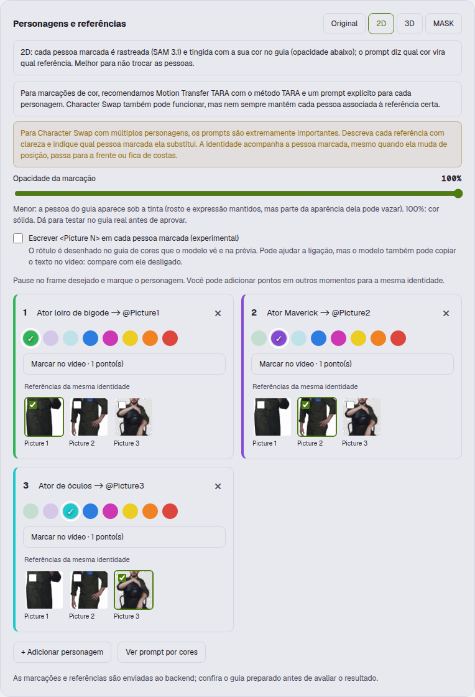
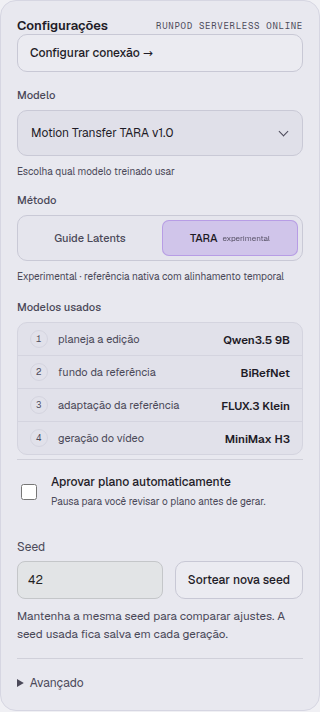
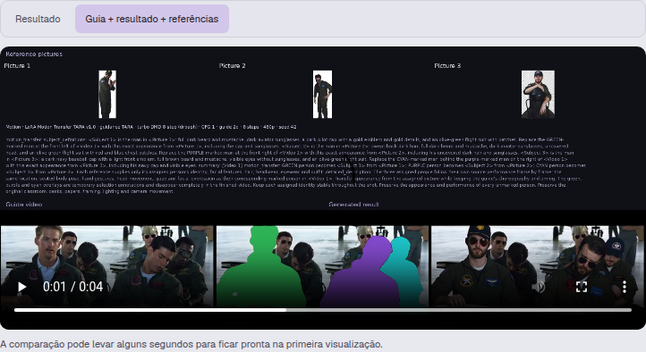

# Henge visual usage guide

[Versão em português](pt-BR/VISUAL-GUIDE.md)

In the studio, click **Tips** in the top bar. The guide is a static page shipped with Henge in `public/guides/` and
served by your own instance at `/guides/index.html` (local, pod or Render); it needs no external service. A
Portuguese version is at `/guides/pt-BR/index.html`, and the studio opens it when the interface is in Portuguese.

It includes real screenshots of the interface, tips on references and prompts, colour marks, TARA, seed,
shots/back views, masks, plan review, result comparison, Head Swap, Sharpness, Molmo2 and the assistant. Images can
be enlarged; the prompt example can be copied. The print button saves the guide as a PDF.

## Multiple characters

Prompts are extremely important. Describe the attributes that set the references apart and keep each identity bound
to the marked person, whatever their position on screen. A back view stays a back view; a person who is absent
must not be created in the shot.



## Model and seed

For colour marks we recommend Motion Transfer TARA with the TARA method and an explicit prompt. Character Swap can
work too; the result depends on how the references are bound and described. Keep the seed to compare one change at
a time, or use **Randomize seed**.



## Checking the swap

Use the comparison with the guide and the references. Check identity, pose, unmarked people, accessories and
continuity. The illustrated tests do not guarantee the behaviour on other shots.



## Updating the screenshots

`scripts/docs/capture-guide.cjs` uses Playwright and existing jobs. It opens an isolated browser context, blocks API
writes and starts no renders, Molmo inference or assistant requests. A prompt example is typed only into that
context's draft, without sending it. The video comparison can be prepared locally by the backend, without AI
inference.

Use a browser with H.264, such as Chrome for Testing, to avoid capturing empty players. The script checks that
support before capturing.

```bash
PLAYWRIGHT_MODULE=/path/to/node_modules/playwright \
CHROMIUM_EXECUTABLE=/path/to/chrome \
node scripts/docs/capture-guide.cjs
```

By default the script looks for the local Maverick tests. In another environment set `HENGE_GUIDE_JOB` (TARA),
`HENGE_CHARACTER_JOB` (Character Swap), `HENGE_MARKS_JOB` (colour preview) and `HENGE_FULL_JOB` (a plan awaiting
approval with several shots). `HENGE_GUIDE_URL` can also be changed.

The run log is in `public/guides/images/capture-manifest.json`. Do not capture settings with credentials or publish
private examples without reviewing the images. The current screenshots were taken with the interface in
Portuguese.

## Checking the guide

`scripts/docs/check-guide.cjs` checks the studio's Tips link, the assets, internal links, enlarging, copying the
prompt and the mobile layout. Use the same browser variables as the capture script.

To update the hosted instance, see [Update on Render](RENDER.md).
