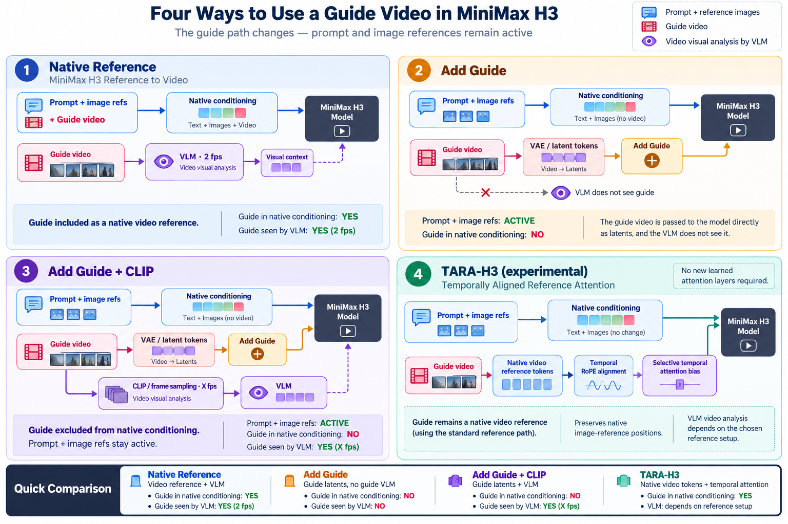

# Guide video conditioning

How the guide video reaches MiniMax H3. The prompt and the reference pictures are always active; only the guide's
path changes.

| Path | Guide in native conditioning | Guide seen by the VLM (Qwen-VL text encoder) | In Henge |
| --- | --- | --- | --- |
| 1. Native Reference | Yes, as a native video reference | Yes (2 fps) | Not offered on its own; TARA builds on it |
| 2. Add Guide | No: VAE latents added with Add Guide | No | Character Swap, Head Swap, Sharpness, Motion · first-frame propagate |
| 3. Add Guide + CLIP | No: VAE latents added with Add Guide | Yes, frames sampled at the CLIP fps setting | Motion Transfer (default Guide Latents method) |
| 4. TARA-H3 (experimental) | Yes, native video reference with temporally aligned attention | Depends on the reference setup | Motion Transfer → Method → TARA |

In plain words:

- **Add Guide**: the guide enters as an image the model traces over, like tracing paper. It copies pose, motion,
  framing and timing frame by frame.
- **Add Guide + CLIP**: the same, plus a few guide frames are shown to the VLM with the prompt, as if someone described
  the video aloud while the model draws. It understands the action better, but it also sees the original performer, so
  clothes or hair can leak. That is why the modes that replace a person (swap, head swap, first-frame propagate) leave
  CLIP off.
- **TARA**: the guide stays a native video reference, and a temporal attention bias keeps each generated frame aligned
  with the matching guide frame. No new trained layers.

Code: `HengeH3Conditioning` (`backend/comfy_nodes/henge/__init__.py`) builds paths 2 and 3; `guide_context` turns the
CLIP frames on, per model (`clip_context` in `backend/workflows.py`). TARA uses `BFSMiniMaxH3NativeTemporal` from
ComfyUI-BFSNodes.
